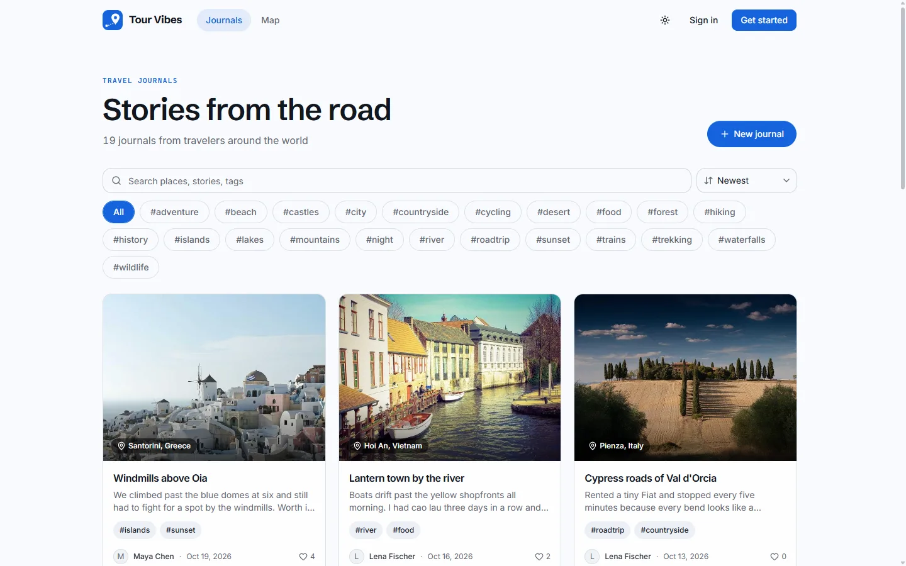
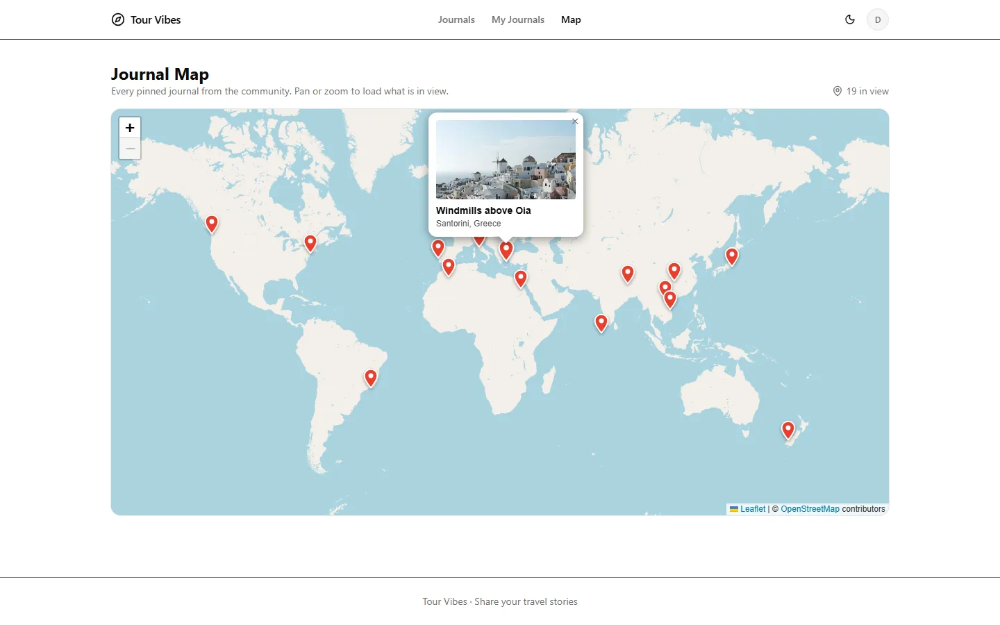
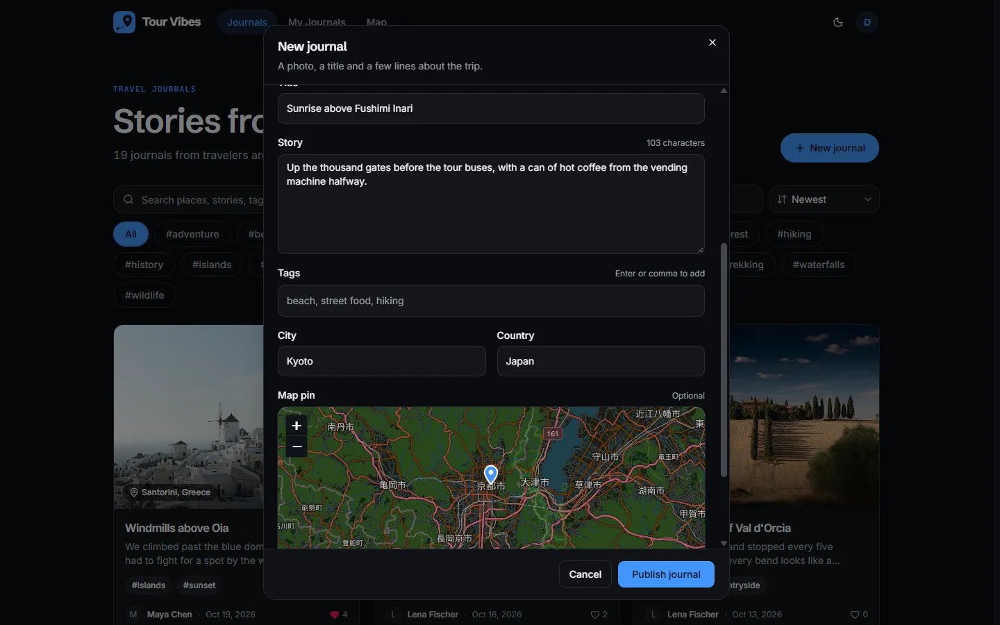
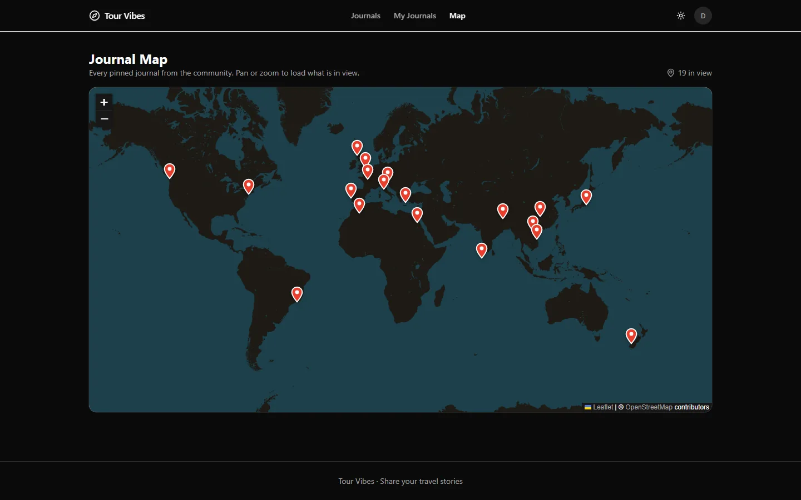
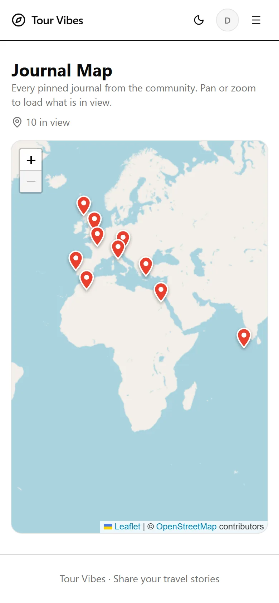
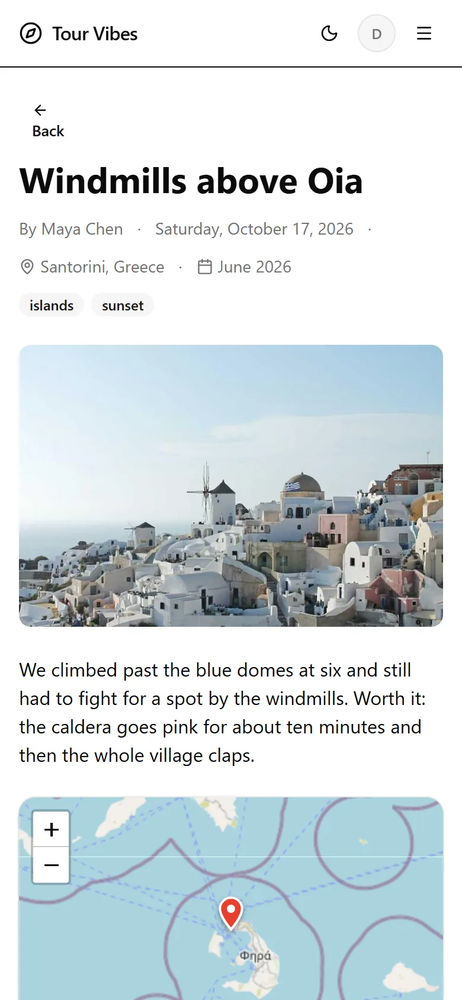
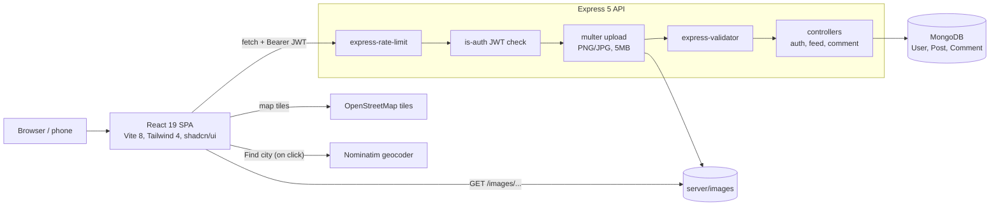

# Tour Vibes

[](https://github.com/Sagargupta16/tour-vibes/actions/workflows/ci.yml)


A full-stack travel journal web application built with the MERN stack. Share travel experiences, photos, and adventures with a community of fellow travelers.

> Note: This is a sample/reference project -- it is not actively deployed. `docker compose up --build` runs the whole stack locally, and `npm run seed` fills it with demo journals.

Started in March 2023 and since rebuilt end to end: React 19 + Vite 8 on the front, an Express 5 REST API on Mongoose 9 at the back, JWT auth, image uploads, likes, comments, tags, full-text search and a map of every pinned journal. The backend checks ownership before every post edit or delete and every comment delete, rate-limits every API route, and accepts uploads only after authentication. 32 API tests run against an in-memory MongoDB on every push.

## Screenshots

Captured with Playwright from a local run seeded with `npm run seed`.

| Community feed                                                                                 | Journal map                                                                                       |
| ---------------------------------------------------------------------------------------------- | ------------------------------------------------------------------------------------------------- |
|  |  |
| **Pin picker in the post form**                                                                | **Map in dark mode**                                                                              |
|   |                         |

<p align="center">
  
  
  
</p>

## Features

- **Authentication** -- signup, login, JWT tokens with 1-hour expiry, auto-logout
- **User Profiles** -- bio, avatar, location, password change
- **Travel Posts** -- create, edit, delete with image uploads, tags, location, and travel date
- **Journal Map** -- every pinned journal on an OpenStreetMap map; panning or zooming loads only the journals in view
- **Map Pin Picker** -- tap the map to pin a journal, drag to adjust, or look the city up through Nominatim
- **Demo Data** -- `npm run seed` loads 5 demo users and 19 pinned journals with photos, likes and comments
- **Likes and Comments** -- like/unlike posts, comment threads with delete
- **Community Feed** -- all posts with pagination, sort by newest/oldest/popular, filter by tag
- **Personal Feed** -- view your own posts
- **Search** -- full-text search across titles, content, and tags
- **Rate Limiting** -- every API route is rate-limited; login, signup and password change get a tighter limit
- **Responsive Design** -- mobile-friendly with hamburger navigation
- **Dark/Light Mode** -- system-aware theme with manual toggle
- **Animations** -- page transitions, hover effects, scroll animations (Framer Motion)
- **Toast Notifications** -- feedback on every user action
- **Skeleton Loading** -- content-shaped placeholders while loading

## Architecture



A request goes through the same layers in the same order: rate limit, JWT check, upload (only on the three routes that take a file), validation, then the controller. Because the upload runs after the JWT check, an anonymous request can never write to disk.

### Design decisions

| Decision                                                          | Why                                                                                                             |
| ----------------------------------------------------------------- | --------------------------------------------------------------------------------------------------------------- |
| JWT in `Authorization` header, 1-hour expiry, client auto-logout  | Stateless API, no session store; the client clears the token on expiry or on any 401 from an authenticated call |
| Popular sort via aggregation (`$size` of `likes`)                 | Likes are an array of user IDs, so a like is idempotent per user and the count is derived, never stored         |
| MongoDB text index on title, content, tags                        | Full-text search with relevance ranking, without running a search service                                       |
| Image path always comes from multer, never the request body       | A client cannot point its post at someone else's file and delete it with its own post                           |
| Stored filenames are `uuid.<ext>` from a MIME whitelist           | No user-controlled names on disk, so no path traversal                                                          |
| One login error for unknown email and wrong password              | The error text does not say which emails exist (signup still reports a taken email)                             |
| Map pins as `location.lat` / `location.lng` with a compound index | `GET /feed/map?bbox=` is two range filters; a view across the date line splits into two longitude ranges        |
| The map refetches on pan or zoom and aborts the previous request  | Only pins in view travel over the wire (capped at 500), and a slow old response cannot replace newer markers    |
| `router.param` checks every `:postId`, `:commentId`, `:userId`    | A malformed id is a 400 before any query runs, instead of a Mongoose CastError surfacing as a 500               |
| Every page but Home is `React.lazy`, vendors in their own chunks  | Leaflet (153 kB) loads only with a map, and an app deploy does not bust the cached React chunk                  |

## Tech Stack

**Frontend:** Vite 8, React 19, Tailwind CSS 4, shadcn/ui, Framer Motion, Sonner
**Backend:** Express 5, Mongoose 9, MongoDB Atlas
**Auth:** JWT + bcryptjs
**Uploads:** Multer (local disk, 5MB limit, PNG/JPG only)
**Maps:** Leaflet + react-leaflet, OpenStreetMap tiles, Nominatim geocoding
**Testing:** node:test, supertest, mongodb-memory-server
**Tooling:** ESLint 9, Prettier, Concurrently, Nodemon, Docker Compose, Renovate, GitHub Actions CI (lint, build, tests, format check, Docker smoke test), CodeQL

## Quick Start

### With Docker (one command)

```bash
git clone https://github.com/Sagargupta16/tour-vibes.git
cd tour-vibes
docker compose up --build
docker compose run --rm api npm run seed   # optional: demo journals
```

Open http://localhost:3000 and use **Try the demo account** on the login page. It calls `POST /auth/demo`, which signs in as `demo@demo.tourvibes.dev` because compose sets `DEMO_EMAIL` on the API, so no demo password is stored anywhere. To sign in through the form instead, seed with your own password (`docker compose run --rm -e DEMO_PASSWORD=... api npm run seed`); without it the demo users get a random password that is never logged. Compose starts MongoDB 8, the API on port 8000 and the built client behind nginx on port 3000, with uploads and data in named volumes. It falls back to a local-only `JWT_SECRET`; set your own (`JWT_SECRET=... docker compose up`) before exposing it anywhere.

### Without Docker

Requires Node 24 (see `.nvmrc`; Vite 8 needs Node 20.19+ or 22.12+) and a MongoDB instance (local or Atlas).

```bash
git clone https://github.com/Sagargupta16/tour-vibes.git
cd tour-vibes
npm run install:all
```

Create `server/.env` from the example:

```bash
cp server/.env.example server/.env
```

Fill in `MONGODB_URI` and `JWT_SECRET` (required). If the API is not on `http://localhost:8000`, copy `client/.env.example` to `client/.env` and set `VITE_API_URL`. Then:

```bash
npm run dev
```

Frontend runs on http://localhost:3000, backend on http://localhost:8000. For demo content, run `npm run seed` in `server/` (it only replaces users on the `demo.tourvibes.dev` domain, so re-running it is safe).

## Scripts

| Command                | Description                                |
| ---------------------- | ------------------------------------------ |
| `npm run dev`          | Start both servers together (concurrently) |
| `npm run server`       | Backend only                               |
| `npm run client`       | Frontend only                              |
| `npm run build`        | Production build of client                 |
| `npm run install:all`  | Install deps in root, server and client    |
| `npm run format`       | Format all JS/CSS with Prettier            |
| `npm run format:check` | Check formatting without writing           |

In `server/`: `npm test` runs the API tests, `npm run seed` loads the demo journals. In `client/`: `npm run bundle:report` prints the JS chunk sizes after `npm run build`.

## Environment Variables

| Variable          | Required    | Default                                | Description                                         |
| ----------------- | ----------- | -------------------------------------- | --------------------------------------------------- |
| `MONGODB_URI`     | Yes         | `mongodb://localhost:27017/tour-vibes` | MongoDB connection string                           |
| `JWT_SECRET`      | Yes         | --                                     | Secret for signing JWT tokens                       |
| `PORT`            | No          | `8000`                                 | Server port                                         |
| `CLIENT_URL`      | No          | `http://localhost:3000`                | Allowed CORS origin                                 |
| `VITE_API_URL`    | No (client) | `http://localhost:8000`                | API base URL baked into the client build            |
| `DEMO_EMAIL`      | No          | --                                     | Seeded demo account `POST /auth/demo` signs in as   |
| `VITE_DEMO_LOGIN` | No (client) | --                                     | `true`: the login page shows a one-click demo login |
| `DEMO_PASSWORD`   | No (seed)   | random, never logged                   | Password for the demo users `npm run seed` creates  |

## API Endpoints

### Auth (`/auth`)

| Method | Endpoint        | Description                                  |
| ------ | --------------- | -------------------------------------------- |
| PUT    | `/signup`       | Register (rate-limited)                      |
| POST   | `/login`        | Login (rate-limited)                         |
| POST   | `/demo`         | Demo login as `DEMO_EMAIL` (rate-limited)    |
| GET    | `/profile`      | Get own profile                              |
| PUT    | `/profile`      | Update profile (name, bio, location, avatar) |
| PUT    | `/password`     | Change password (rate-limited)               |
| GET    | `/user/:userId` | View public profile                          |

### Feed (`/feed`)

| Method | Endpoint                              | Description                                            |
| ------ | ------------------------------------- | ------------------------------------------------------ |
| GET    | `/posts?page=1&sort=newest&tag=beach` | List posts (paginated, filterable)                     |
| GET    | `/posts/:userId`                      | User's posts                                           |
| POST   | `/posts`                              | Create post (multipart form, optional `lat`/`lng` pin) |
| GET    | `/post/:postId`                       | Single post                                            |
| PUT    | `/post/:postId`                       | Update post                                            |
| DELETE | `/post/:postId`                       | Delete post                                            |
| GET    | `/search?q=keyword`                   | Full-text search                                       |
| GET    | `/tags`                               | All unique tags                                        |
| GET    | `/map?bbox=west,south,east,north`     | Pinned posts in the box (max 500)                      |
| PUT    | `/post/:postId/like`                  | Toggle like                                            |
| GET    | `/post/:postId/comments`              | List comments                                          |
| POST   | `/post/:postId/comments`              | Add comment                                            |
| DELETE | `/comment/:commentId`                 | Delete comment                                         |

## Testing

`npm test` in `server/` runs 32 tests with `node:test` and supertest against the real Express app and an in-memory MongoDB (mongodb-memory-server). CI runs them on every push. They cover:

- Security regressions: anonymous uploads never touch disk, a user cannot hijack and delete another user's image, cross-user edit and delete are 403, one login error for unknown email and wrong password, a NoSQL operator in place of the email is rejected, a wrong current password is a 422 that keeps the session, uploads over 5MB are a 413, a malformed id is a 400, every route sends rate-limit headers, the demo login is off without `DEMO_EMAIL`
- Feed behaviour: create with tags and pin, validation, newest/oldest/popular sorts, tag filter, pagination, text search, likes, comments, delete cascade
- The map query: bounding boxes, a box across the antimeridian, world-wide boxes, malformed `bbox`

## Bundle size

Measured with `npm run bundle:report` (raw and gzip sizes, kB = 1000 bytes). Before is commit `65e16ce`, the last commit before route splitting.

|                                 |    Before |              After |
| ------------------------------- | --------: | -----------------: |
| JS loaded on first paint (raw)  | 673.12 kB | 596.27 kB (-11.4%) |
| JS loaded on first paint (gzip) | 210.59 kB |  191.54 kB (-9.0%) |
| Largest chunk (raw)             | 673.12 kB |          232.72 kB |
| JS chunks                       |         1 |                 25 |

The first paint is smaller even though the app gained a whole map stack: Leaflet and react-leaflet (153.29 kB raw) load only on the map page, a pinned journal or the post form. The build no longer warns about chunks over 500 kB.

## Project Structure

```
tour-vibes/
├── client/src/
│   ├── components/ui/    # shadcn/ui primitives
│   ├── components/layout/# Header, mobile nav, root layout
│   ├── components/feed/  # Post card, post form, search, tags, sort
│   ├── components/post/  # Like button, comments
│   ├── components/profile/# Profile + password forms
│   ├── components/map/   # Leaflet map shell, pin icon, pin picker, post map
│   ├── components/shared/# Page transitions, skeletons, empty state, page loader
│   ├── contexts/         # Auth + Theme providers
│   ├── hooks/            # useFeed, useMapPosts, useDebounce
│   ├── lib/              # API client, geocoder, validators, utils
│   └── pages/            # Home, Login, Signup, Feed, My Journals, Single Post, Map, Profile, 404
├── client/scripts/       # bundle-report.mjs
├── server/
│   ├── controllers/      # Route handlers (auth, feed, like, map, comment)
│   ├── middleware/       # JWT auth, multer upload, ObjectId check
│   ├── models/           # Mongoose schemas (User, Post, Comment)
│   ├── routes/           # Express route definitions
│   ├── util/             # Shared helpers
│   ├── test/             # node:test API suite
│   ├── scripts/          # seed.js
│   ├── seed/             # Demo journals (data.json) and credited photos
│   └── images/           # Uploaded images (gitignored)
├── docs/screenshots/     # README screenshots
├── docker-compose.yml    # MongoDB + API + client
├── package.json          # Root scripts (dev, format, build)
├── .prettierrc           # Code formatting config
└── CLAUDE.md             # AI assistant instructions
```

## Contributing

1. Fork the repository
2. Create a feature branch (`git checkout -b feature/your-feature`)
3. Commit changes using conventional commits (`feat:`, `fix:`, `refactor:`)
4. Push and open a Pull Request

## More Projects

| Project                                                                                | Description                                                            |
| -------------------------------------------------------------------------------------- | ---------------------------------------------------------------------- |
| [claude-cost-optimizer](https://github.com/Sagargupta16/claude-cost-optimizer)         | Save 30-60% on Claude Code costs - proven strategies and benchmarks    |
| [Financial Dashboard](https://github.com/Sagargupta16/Financial-Dashboard)             | Modern React financial dashboard with analytics and data visualization |
| [InstagramLikesLeaderboard](https://github.com/Sagargupta16/InstagramLikesLeaderboard) | Browser tool showing who likes your Instagram posts the most           |
| [LeetCode Rating Predictor](https://github.com/Sagargupta16/LeetCode_Rating_Predictor) | Full-stack ML-powered LeetCode contest rating predictor                |

## License

[MIT](LICENSE)
