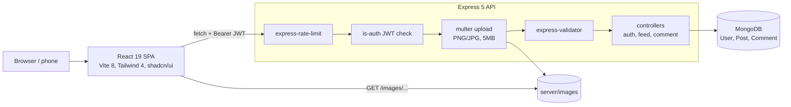

# Tour Vibes

[](https://github.com/Sagargupta16/tour-vibes/actions/workflows/ci.yml)


A full-stack travel journal web application built with the MERN stack. Share travel experiences, photos, and adventures with a community of fellow travelers.

> Note: This is a sample/reference project -- it is not actively deployed.

Started in March 2023 and since rebuilt end to end: React 19 + Vite 8 on the front, an Express 5 REST API on Mongoose 9 at the back, JWT auth, image uploads, likes, comments, tags and full-text search. The backend checks ownership before every post edit or delete and every comment delete, rate-limits every API route, and accepts uploads only after authentication.

## Features

- **Authentication** -- signup, login, JWT tokens with 1-hour expiry, auto-logout
- **User Profiles** -- bio, avatar, location, password change
- **Travel Posts** -- create, edit, delete with image uploads, tags, location, and travel date
- **Likes and Comments** -- like/unlike posts, comment threads with delete
- **Community Feed** -- all posts with pagination, sort by newest/oldest/popular, filter by tag
- **Personal Feed** -- view your own posts
- **Search** -- full-text search across titles, content, and tags
- **Rate Limiting** -- auth endpoints rate-limited to prevent brute force
- **Responsive Design** -- mobile-friendly with hamburger navigation
- **Dark/Light Mode** -- system-aware theme with manual toggle
- **Animations** -- page transitions, hover effects, scroll animations (Framer Motion)
- **Toast Notifications** -- feedback on every user action
- **Skeleton Loading** -- content-shaped placeholders while loading

## Architecture



A request goes through the same layers in the same order: rate limit, JWT check, upload (only on the three routes that take a file), validation, then the controller. Because the upload runs after the JWT check, an anonymous request can never write to disk.

### Design decisions

| Decision                                                         | Why                                                                                                             |
| ---------------------------------------------------------------- | --------------------------------------------------------------------------------------------------------------- |
| JWT in `Authorization` header, 1-hour expiry, client auto-logout | Stateless API, no session store; the client clears the token on expiry or on any 401 from an authenticated call |
| Popular sort via aggregation (`$size` of `likes`)                | Likes are an array of user IDs, so a like is idempotent per user and the count is derived, never stored         |
| MongoDB text index on title, content, tags                       | Full-text search with relevance ranking, without running a search service                                       |
| Image path always comes from multer, never the request body      | A client cannot point its post at someone else's file and delete it with its own post                           |
| Stored filenames are `uuid.<ext>` from a MIME whitelist          | No user-controlled names on disk, so no path traversal                                                          |
| One login error for unknown email and wrong password             | The login endpoint does not reveal which emails are registered                                                  |

## Tech Stack

**Frontend:** Vite 8, React 19, Tailwind CSS 4, shadcn/ui, Framer Motion, Sonner
**Backend:** Express 5, Mongoose 9, MongoDB Atlas
**Auth:** JWT + bcryptjs
**Uploads:** Multer (local disk, 5MB limit, PNG/JPG only)
**Tooling:** ESLint 9, Prettier, Concurrently, Nodemon, Renovate, GitHub Actions CI (lint, build, format check), CodeQL

## Quick Start

Requires Node 24 (see `.nvmrc`; Vite 8 needs Node 20.19+ or 22.12+) and a MongoDB instance (local or Atlas).

```bash
git clone https://github.com/Sagargupta16/tour-vibes.git
cd tour-vibes
npm run install:all
```

Create `server/.env` from the example:

```bash
cp server/.env.example server/.env
```

Fill in `MONGODB_URI` and `JWT_SECRET` (required). If the API is not on `http://localhost:8000`, copy `client/.env.example` to `client/.env` and set `VITE_API_URL`. Then:

```bash
npm run dev
```

Frontend runs on http://localhost:3000, backend on http://localhost:8000.

## Scripts

| Command                | Description                                |
| ---------------------- | ------------------------------------------ |
| `npm run dev`          | Start both servers together (concurrently) |
| `npm run server`       | Backend only                               |
| `npm run client`       | Frontend only                              |
| `npm run build`        | Production build of client                 |
| `npm run install:all`  | Install deps in root, server and client    |
| `npm run format`       | Format all JS/CSS with Prettier            |
| `npm run format:check` | Check formatting without writing           |

## Environment Variables

| Variable       | Required    | Default                                | Description                              |
| -------------- | ----------- | -------------------------------------- | ---------------------------------------- |
| `MONGODB_URI`  | Yes         | `mongodb://localhost:27017/tour-vibes` | MongoDB connection string                |
| `JWT_SECRET`   | Yes         | --                                     | Secret for signing JWT tokens            |
| `PORT`         | No          | `8000`                                 | Server port                              |
| `CLIENT_URL`   | No          | `http://localhost:3000`                | Allowed CORS origin                      |
| `VITE_API_URL` | No (client) | `http://localhost:8000`                | API base URL baked into the client build |

## API Endpoints

### Auth (`/auth`)

| Method | Endpoint        | Description                                  |
| ------ | --------------- | -------------------------------------------- |
| PUT    | `/signup`       | Register (rate-limited)                      |
| POST   | `/login`        | Login (rate-limited)                         |
| GET    | `/profile`      | Get own profile                              |
| PUT    | `/profile`      | Update profile (name, bio, location, avatar) |
| PUT    | `/password`     | Change password (rate-limited)               |
| GET    | `/user/:userId` | View public profile                          |

### Feed (`/feed`)

| Method | Endpoint                              | Description                        |
| ------ | ------------------------------------- | ---------------------------------- |
| GET    | `/posts?page=1&sort=newest&tag=beach` | List posts (paginated, filterable) |
| GET    | `/posts/:userId`                      | User's posts                       |
| POST   | `/posts`                              | Create post (multipart form)       |
| GET    | `/post/:postId`                       | Single post                        |
| PUT    | `/post/:postId`                       | Update post                        |
| DELETE | `/post/:postId`                       | Delete post                        |
| GET    | `/search?q=keyword`                   | Full-text search                   |
| GET    | `/tags`                               | All unique tags                    |
| PUT    | `/post/:postId/like`                  | Toggle like                        |
| GET    | `/post/:postId/comments`              | List comments                      |
| POST   | `/post/:postId/comments`              | Add comment                        |
| DELETE | `/comment/:commentId`                 | Delete comment                     |

## Project Structure

```
tour-vibes/
├── client/src/
│   ├── components/ui/    # shadcn/ui primitives
│   ├── components/layout/# Header, mobile nav, root layout
│   ├── components/feed/  # Post card, post form, search, tags, sort
│   ├── components/post/  # Like button, comments
│   ├── components/profile/# Profile + password forms
│   ├── components/shared/# Page transitions, skeletons, empty state
│   ├── contexts/         # Auth + Theme providers
│   ├── hooks/            # useFeed, useDebounce
│   ├── lib/              # API client, validators, utils
│   └── pages/            # Home, Login, Signup, Feed, My Journals, Single Post, Profile, 404
├── server/
│   ├── controllers/      # Route handlers (auth, feed, comment)
│   ├── middleware/       # JWT auth, multer upload
│   ├── models/           # Mongoose schemas (User, Post, Comment)
│   ├── routes/           # Express route definitions
│   ├── util/             # Shared helpers
│   └── images/           # Uploaded images (gitignored)
├── package.json          # Root scripts (dev, format, build)
├── .prettierrc           # Code formatting config
└── CLAUDE.md             # AI assistant instructions
```

## Contributing

1. Fork the repository
2. Create a feature branch (`git checkout -b feature/your-feature`)
3. Commit changes using conventional commits (`feat:`, `fix:`, `refactor:`)
4. Push and open a Pull Request

## More Projects

| Project                                                                                | Description                                                            |
| -------------------------------------------------------------------------------------- | ---------------------------------------------------------------------- |
| [claude-cost-optimizer](https://github.com/Sagargupta16/claude-cost-optimizer)         | Save 30-60% on Claude Code costs - proven strategies and benchmarks    |
| [Financial Dashboard](https://github.com/Sagargupta16/Financial-Dashboard)             | Modern React financial dashboard with analytics and data visualization |
| [InstagramLikesLeaderboard](https://github.com/Sagargupta16/InstagramLikesLeaderboard) | Browser tool showing who likes your Instagram posts the most           |
| [LeetCode Rating Predictor](https://github.com/Sagargupta16/LeetCode_Rating_Predictor) | Full-stack ML-powered LeetCode contest rating predictor                |

## License

[MIT](LICENSE)
